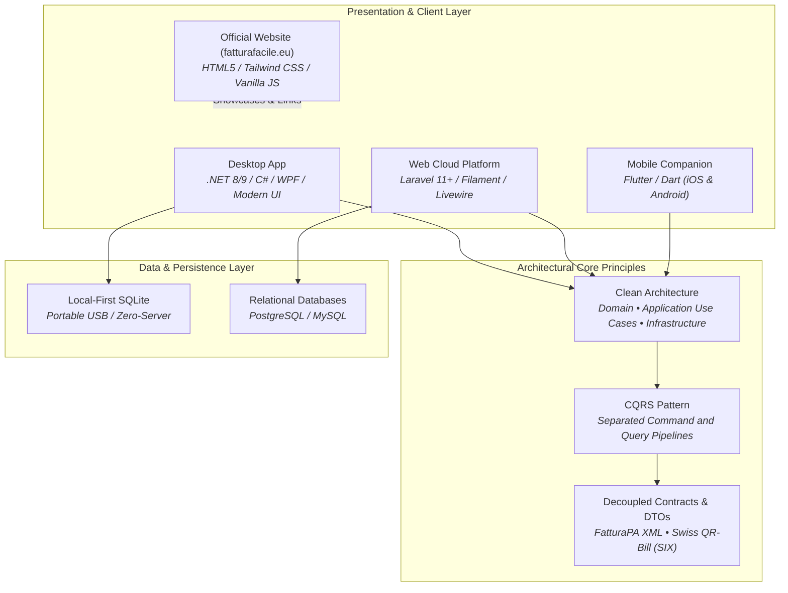

<div align="center">

# FatturaFacile — Official Showcase & Documentation (`fatturafacile.eu`)

### Official Institutional Showcase & Multi-Language Landing Page

[](https://opensource.org/licenses/MIT)
[](https://fatturafacile.eu)
[](src/CONTRIBUTING.md)
[](https://github.com/FatturaFacile/website/actions/workflows/deploy-pages.yml)

The official public showcase, documentation, and institutional landing page ([fatturafacile.eu](https://fatturafacile.eu)) for the **FatturaFacile** open-source invoicing ecosystem — designed for tradespeople, freelancers, and small-to-medium businesses across **Italy** (FatturaPA / SDI) and **Switzerland** (SIX QR-Bill).

[Overview](#-overview) • [Ecosystem Architecture](#-ecosystem--architecture) • [Tech Stack](#-tech-stack) • [Repository Structure](#-repository-structure) • [Local Development & Testing](#-local-development--testing) • [Deployment Pipeline](#-deployment-pipeline) • [Contributing](#-contributing) • [License](#-license)

</div>

---

## 🌐 Overview

This repository contains the source code for **[fatturafacile.eu](https://fatturafacile.eu)**. It articulates the philosophy, high-level architecture, compliance guarantees (EU GDPR & Swiss FADP/nLPD), and distribution channels for the **FatturaFacile** ecosystem.

### Key Highlights

- **Zero-Build Static Architecture:** Ultra-fast page loading and high Lighthouse scores with zero build step overhead.
- **Client-Side Internationalization (`EN`, `IT`, `FR`, `DE`):** Zero-dependency reactive i18n engine (`src/js/translations.js` + `src/js/main.js`) with persistent language selection and real-time attribute updates.
- **Adaptive Dark / Light Theme:** First-class color scheme support reflecting OS preferences (`prefers-color-scheme`) with manual toggle persistence and vector brand adaptation.
- **SEO & Compliance Ready:** Complete Open Graph, Twitter Cards, Schema.org (`SoftwareApplication` JSON-LD), canonical links, `robots.txt`, and `sitemap.xml`.
- **Interactive Legal Modal:** Built-in EU GDPR (EU 2016/679) and Swiss nLPA/FADP data protection overview accessible directly from the interface.

---

## 🏛 Ecosystem & Architecture

The **FatturaFacile** suite is designed as a decoupled, multi-tier ecosystem adhering to **Clean Architecture**, **CQRS (Command Query Responsibility Segregation)**, and **SOLID** principles:



### Sibling Repositories

| Component            | Repository                                                          | Stack / Technology              | Purpose                                                                                              |
| :------------------- | :------------------------------------------------------------------ | :------------------------------ | :--------------------------------------------------------------------------------------------------- |
| **Official Website** | [`FatturaFacile/website`](https://github.com/FatturaFacile/website) | HTML5, Tailwind CSS, Vanilla JS | Public showcase, landing page, and documentation hub ([fatturafacile.eu](https://fatturafacile.eu)). |
| **Desktop Client**   | [`FatturaFacile/desktop`](https://github.com/FatturaFacile/desktop) | .NET 8/9, C#, WPF, SQLite       | High-performance native Windows client with local-first, offline-first USB execution.                |
| **Web Platform**     | [`FatturaFacile/web`](https://github.com/FatturaFacile/web)         | Laravel 11+, Filament, Livewire | Multi-user self-hosted cloud platform with admin portals, APIs, and team billing.                    |
| **Mobile Companion** | [`FatturaFacile/mobile`](https://github.com/FatturaFacile/mobile)   | Flutter, Dart                   | iOS & Android companion for field invoicing, quick estimates, and receipt capture.                   |
| **Brand Assets**     | [`FatturaFacile/assets`](https://github.com/FatturaFacile/assets)   | SVG, Figma, Design Tokens       | Official vector logos, typography guidelines, and digital media kits.                                |

---

## 🛠 Tech Stack

| Layer                   | Technology                    | Description                                                                                                     |
| :---------------------- | :---------------------------- | :-------------------------------------------------------------------------------------------------------------- |
| **Markup**              | **HTML5 Semantic**            | Accessible (`ARIA`), SEO-optimized single-page layout (`src/index.html`).                                       |
| **Styling**             | **Tailwind CSS (CDN) + CSS3** | Utility-first responsive design, dark mode class switching, custom scrollbars (`src/css/style.css`).            |
| **Client Scripting**    | **Vanilla JavaScript (ES6+)** | Lightweight state management for theme, i18n, FAQ accordions, and modals (`src/js/main.js`).                    |
| **Localization**        | **JavaScript Dictionary**     | Typed client dictionary for English, Italian, French, and German (`src/js/translations.js`).                    |
| **Assets & Media**      | **SVG & WebManifest**         | Responsive vector graphics (`src/img/`) and multi-platform progressive app favicons (`src/img/favicon/`).       |
| **Continuous Delivery** | **GitHub Actions**            | Automated validation and deployment pipeline targeting **GitHub Pages** (`.github/workflows/deploy-pages.yml`). |

---

## 📁 Repository Structure

```text
website/
├── .github/
│   └── workflows/
│       └── deploy-pages.yml        # GitHub Actions workflow for GitHub Pages deployment
├── src/                            # Web root directory deployed to production
│   ├── index.html                  # Main application markup & SEO entry point
│   ├── robots.txt                  # Search crawler directives
│   ├── sitemap.xml                 # Search engine XML index
│   ├── CHANGELOG.md                # Project changelog (Keep a Changelog format)
│   ├── CODE_OF_CONDUCT.md          # Contributor Covenant v2.1 code of conduct
│   ├── CONTRIBUTING.md             # Contributor & translation guidelines
│   ├── css/
│   │   └── style.css               # Utility overlays, transitions, and scrollbar styles
│   ├── js/
│   │   ├── main.js                 # Theme controller, i18n engine, accordion, and modal handlers
│   │   └── translations.js         # Multi-language dictionary (EN, IT, FR, DE)
│   └── img/
│       ├── fattura_facile.svg                      # Primary brand vector logo
│       ├── fattura_facile_logo.svg                 # Open Graph and metadata vector logo
│       ├── fattura_facile_logo_trasparente.svg     # Transparent background vector logo
│       ├── fattura_facile_favicon.svg              # Vector favicon
│       ├── fattura_facile_favicon_trasparente.svg  # Transparent vector favicon
│       ├── logo-email.png                          # Raster signature logo
│       └── favicon/                                # Multi-resolution app favicons & manifest
│           ├── android-chrome-192x192.png
│           ├── android-chrome-512x512.png
│           ├── apple-touch-icon.png
│           ├── favicon-16x16.png
│           ├── favicon-32x32.png
│           ├── favicon-43x44.png
│           ├── favicon.ico
│           └── site.webmanifest
├── LICENSE                         # MIT License
└── README.md                       # Repository documentation
```

---

## 🚀 Local Development & Testing

Because the website requires zero build compilation, you can run and test it instantly using any static server.

### 1. Clone the Repository

```bash
git clone https://github.com/FatturaFacile/website.git
cd website
```

### 2. Run Local Development Server

Choose any of the following lightweight static servers:

#### Option A — Python (`http.server`)

```bash
# Serve directly from the web root folder (src)
python -m http.server 8080 --directory src
```

Navigate to [http://localhost:8080](http://localhost:8080).

#### Option B — Node.js (`npx serve`)

```bash
npx serve src -l 8080
```

#### Option C — VS Code Live Server

1. Open the `website` workspace in Visual Studio Code.
2. Expand the `src` folder, right-click `src/index.html`, and select **"Open with Live Server"**.

#### Option D — Docker (Nginx)

```bash
docker run --rm -p 8080:80 -v "${PWD}/src:/usr/share/nginx/html:ro" nginx:alpine
```

Navigate to [http://localhost:8080](http://localhost:8080).

### 3. Verification & Testing Checklist

- [ ] **Cross-Language Validation:** Toggle between `EN`, `IT`, `FR`, and `DE` in the top bar to verify all keys render cleanly without falling back to raw keys.
- [ ] **Dark / Light Mode:** Switch themes via the sun/moon button and verify high-contrast readability across all cards and typography.
- [ ] **Modal Verification:** Click the **GDPR & Privacy Guarantee** badge in the footer to ensure the modal opens, locks background scroll, and closes cleanly via `Escape` or the button.
- [ ] **Responsive Breakpoints:** Verify navigation layout on mobile (`<640px`), tablet (`768px`), and desktop (`1024px+`).

---

## ☁️ Deployment Pipeline

The production website is deployed automatically via **GitHub Actions** to **GitHub Pages**:

- **Workflow File:** [`.github/workflows/deploy-pages.yml`](.github/workflows/deploy-pages.yml)
- **Trigger:** Push to the `main` branch or manual trigger via `workflow_dispatch`.
- **Permissions Required:**
  ```yaml
  permissions:
    contents: read
    pages: write
    id-token: write
  ```
- **Artifact Path:** Target directory is `./src`, publishing the pure static application assets directly without redundant root files.
- **Custom Domain:** Configured for [fatturafacile.eu](https://fatturafacile.eu) with automatic SSL provisioning.

---

## 🤝 Contributing

We welcome community feedback, translations, accessibility improvements, and documentation fixes! Please review:

- [Contributing Guidelines](src/CONTRIBUTING.md)
- [Code of Conduct](src/CODE_OF_CONDUCT.md)
- [Changelog](src/CHANGELOG.md)

---

## 📄 License

Distributed under the **[MIT License](LICENSE)**. Copyright &copy; 2026 **FatturaFacile**.
